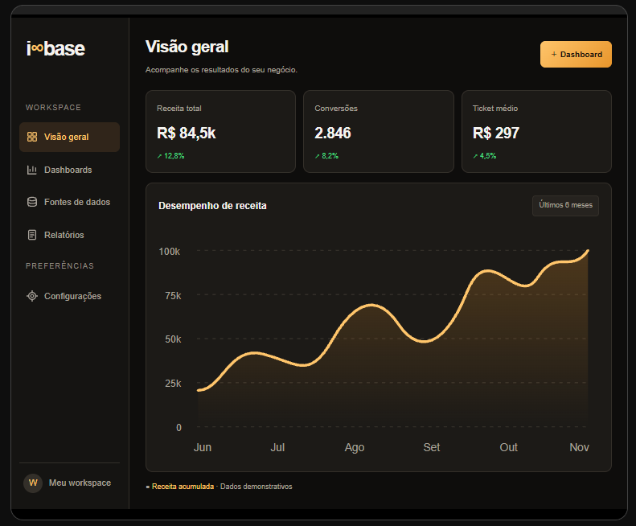

# Assets

Documentos, imagens e protótipos de design da IoBase.

## Decisões de design

### Direção visual

A IoBase é um SaaS com interface **dark-first**: fundos em grafite quente, texto em off-white e dourado usado como acento. A intenção é uma sensação de produto sofisticado e calmo, em que o dourado guia a atenção sem competir com o conteúdo.

### Logo

- Wordmark "iobase" em off-white (`#F5F3EF`), com o "o" substituído por um símbolo de infinito em gradiente dourado (de Soft Gold para Amber Gold).
- O gradiente do símbolo é o único ponto de cor da marca, então deve aparecer com destaque e não ser repetido em excesso na interface.
- Arquivos: `brand/logo.png`, `brand/Ibv1.png`, `brand/Ibv2.png`, `brand/favicon.png`, `brand/favicon-fullquality.png`.

### Paleta

**Cores da marca**

| Nome        | Hex       | Uso                                              |
|-------------|-----------|--------------------------------------------------|
| Soft Gold   | `#FFC56B` | Destaques claros, início do gradiente da marca   |
| Amber Gold  | `#E8952B` | Acento principal, botões e estados de ação       |
| Off White   | `#F5F3EF` | Texto principal e logo sobre fundo escuro        |

**Fundos e superfícies** (camadas de profundidade, do mais fundo ao mais alto)

| Nome       | Hex       | Uso                                 |
|------------|-----------|-------------------------------------|
| Background | `#0E0D0C` | Fundo da aplicação                  |
| Sidebar    | `#151412` | Barra lateral de navegação          |
| Surface    | `#1C1A17` | Cards e painéis                     |
| Elevated   | `#26231F` | Modais, dropdowns, itens em hover   |

**Neutros** (texto, bordas e elementos secundários)

| Nome         | Hex       | Uso                                       |
|--------------|-----------|-------------------------------------------|
| Foreground   | `#F5F3EF` | Texto principal                           |
| Muted text   | `#A8A29A` | Descrições, legendas, metadados           |
| Subtle text  | `#746E66` | Placeholders, textos desabilitados        |
| Border       | `#332F29` | Divisórias, bordas de inputs e cards      |

### Princípios de cor

1. **Sem cinzas azulados.** Os fundos são grafites com leve temperatura quente. Isso harmoniza com o dourado da logo; cinzas frios criariam um contraste artificial com a marca.
2. **Dourado como acento, não como superfície.** Usamos Amber Gold e Soft Gold em ações primárias, indicadores de foco e estados ativos. Nunca em grandes áreas de fundo.
3. **Off-white no lugar do branco puro.** `#F5F3EF` evita contraste agressivo sobre fundo escuro e mantém a temperatura da marca.
4. **Hierarquia por luminosidade.** A profundidade vem da progressão Background → Sidebar → Surface → Elevated, não de sombras pesadas.
5. **Texto em três níveis.** Foreground para conteúdo, Muted para apoio, Subtle para elementos de baixa prioridade. Cada nível precisa continuar legível sobre todas as superfícies; validar contraste antes de usar Subtle em texto corrido.

### Gradiente da marca

- Direção: de Soft Gold (`#FFC56B`) para Amber Gold (`#E8952B`).
- Especificação: `linear-gradient(135deg, #FFC56B 0%, #E8952B 100%)`.
- Uso: botões principais, elementos selecionados, identidade visual (logo) e detalhes da landing page.
- Nos dashboards, usar cores sólidas. O gradiente não é usado em áreas de dados.

### Cores semânticas e gráficos

Como a IoBase trabalha com Business Intelligence, as cores de dados precisam de identidade própria, complementar ao dourado, sem que todo gráfico seja dourado.

**Status**

| Nome        | Hex       | Uso                          |
|-------------|-----------|------------------------------|
| Success     | `#4ADE80` | Variação positiva, metas batidas |
| Error       | `#F87171` | Falhas, variação negativa, ações destrutivas |
| Warning     | `#FBBF24` | Atenção, dados desatualizados |
| Information | `#60A5FA` | Dicas, informações neutras   |

**Categorias de gráfico** (ordem de uso)

| Ordem | Nome   | Hex       |
|-------|--------|-----------|
| 1     | Gold   | `#FFC56B` |
| 2     | Blue   | `#60A5FA` |
| 3     | Teal   | `#2DD4BF` |
| 4     | Violet | `#A78BFA` |
| 5     | Red    | `#F87171` |
| 6     | Muted  | `#A8A29A` |

Regra: séries de dados seguem a ordem da tabela. Dourado fica para a série principal ou para o destaque; não usar como cor de todas as séries.

### Tipografia

| Família        | Uso                                  | Exemplo                                  |
|----------------|--------------------------------------|------------------------------------------|
| **Outfit**     | Títulos e marketing                  | "Transforme dados em decisões."          |
| **Inter**      | Interface e dashboards               | "R$ 128.540,00" / "Acompanhe seus indicadores." |
| **JetBrains Mono** | Dados técnicos e consultas       | `SELECT * FROM analytics;`               |

Outfit + Inter são a base. JetBrains Mono aparece apenas em áreas técnicas (consultas SQL, IDs, código).

### Proporção de cores

| Proporção | Papel                | Cores                               |
|-----------|----------------------|-------------------------------------|
| 70%       | Fundos neutros       | Background, Sidebar, Surface, Elevated |
| 20%       | Textos e elementos   | Foreground, Muted, Subtle, Border   |
| 10%       | Destaques da marca   | Soft Gold, Amber Gold, gradiente    |

O dourado é a assinatura da IoBase, não a cor dominante. A interface deve parecer premium e profissional, não excessivamente decorada.

### Tokens de design

Os tokens abaixo devem ser padronizados no CSS global do projeto. Este README é a referência; a implementação fica no código.

```css
:root {
  /* Brand */
  --primary: #FFC56B;
  --primary-dark: #E8952B;
  --primary-foreground: #20160C;
  --brand-gradient: linear-gradient(135deg, #FFC56B 0%, #E8952B 100%);

  /* Backgrounds */
  --background: #0E0D0C;
  --sidebar: #151412;
  --card: #1C1A17;
  --popover: #26231F;

  /* Typography */
  --foreground: #F5F3EF;
  --muted-foreground: #A8A29A;
  --subtle-foreground: #746E66;

  /* Components */
  --border: #332F29;
  --input: #26231F;
  --ring: #FFC56B;
  --accent: #30251A;
  --accent-foreground: #FFC56B;

  /* Status */
  --success: #4ADE80;
  --destructive: #F87171;
  --warning: #FBBF24;
  --info: #60A5FA;

  /* Charts */
  --chart-1: #FFC56B;
  --chart-2: #60A5FA;
  --chart-3: #2DD4BF;
  --chart-4: #A78BFA;
  --chart-5: #F87171;
  --chart-6: #A8A29A;
}
```

### Aplicação no produto

A paleta aplicada a um dashboard real da IoBase (visão geral de receita):



O que a simulação mostra:

- **Navegação:** a sidebar em `#151412` com o item ativo destacado em dourado sobre fundo levemente elevado.
- **Ação primária:** o botão "+ Dashboard" usa o gradiente Soft Gold → Amber Gold, o único elemento de cor saturada da tela.
- **Gráfico:** a linha de receita é Soft Gold, com preenchimento que desvanece em direção ao fundo. Dourado segue como dado principal, sem competir com o restante.
- **Cards de métricas:** superfícies `#1C1A17` com bordas `#332F29`; valores em Foreground e rótulos em Muted.

Os indicadores de variação positiva (↗ 12,8%, etc.) usam Success (`#4ADE80`), definido na paleta de status.

## Em aberto

- [ ] Definir escala tipográfica (tamanhos e pesos de Outfit e Inter).
- [ ] Definir escala de espaçamento e raios de borda.
- [ ] Validar contraste WCAG de todas as combinações texto/fundo, incluindo Subtle e as cores de status sobre Surface.
- [ ] Definir versão clara da interface, se houver.

## Estrutura da pasta

```
Assets/
├── README.md
├── mockups/
│   └── dashboard-visao-geral.png
└── brand/
    ├── logo.png
    ├── Ibv1.png
    ├── Ibv2.png
    ├── favicon.png
    └── favicon-fullquality.png
```
